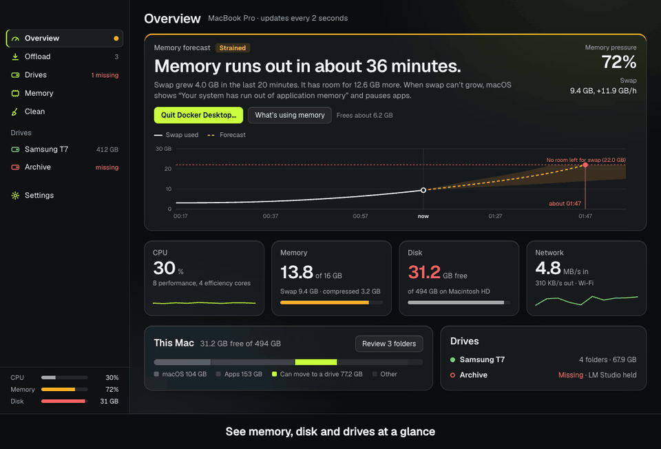
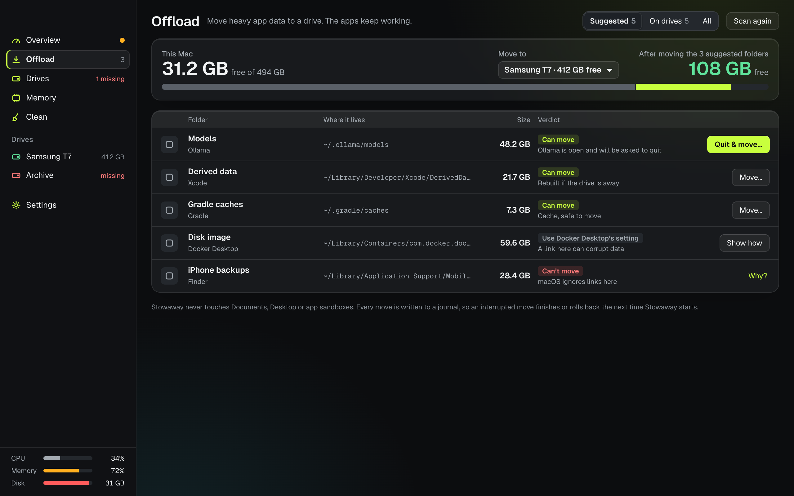
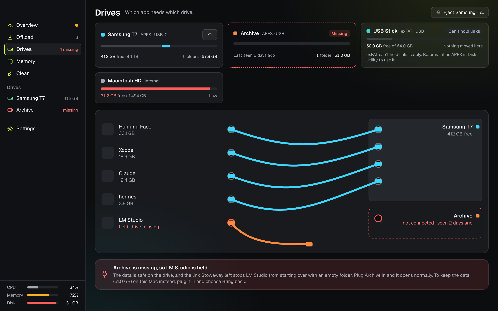
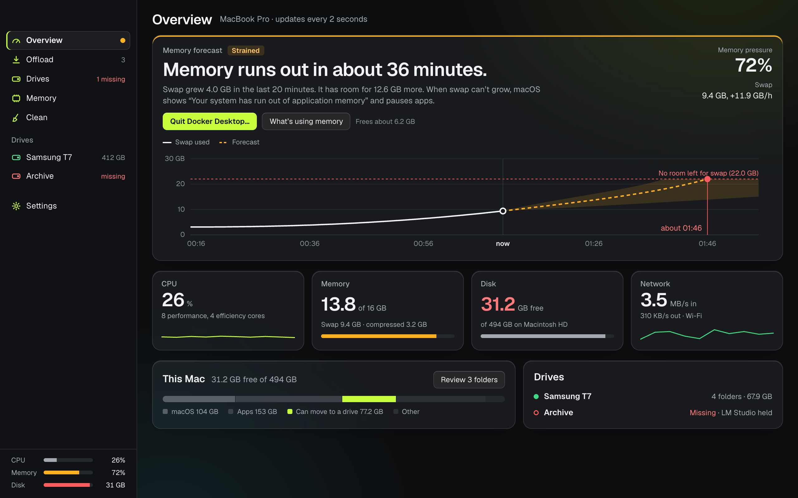
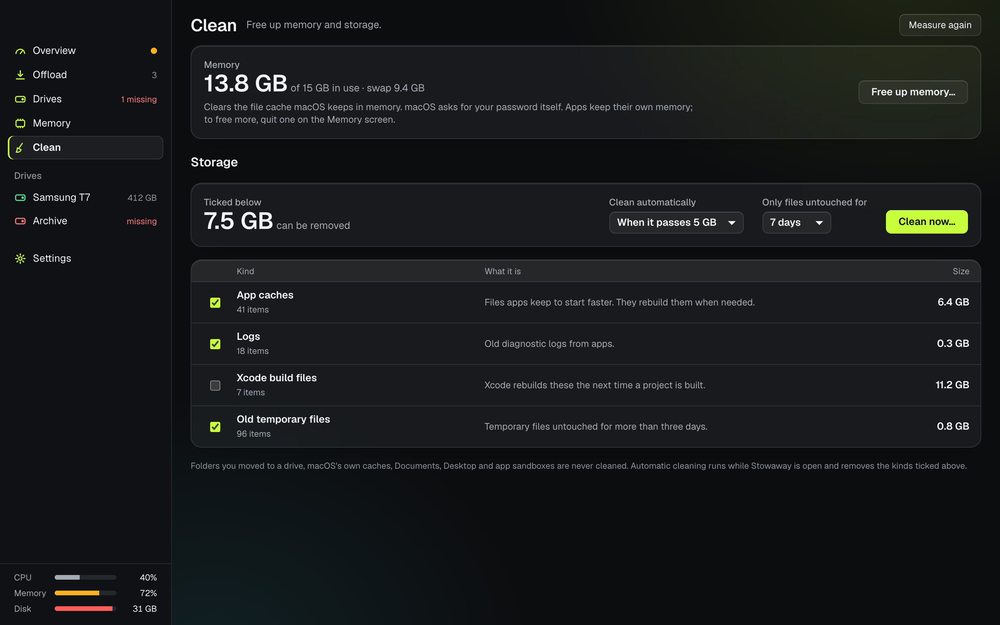

# Stowaway

Make room on your Mac. Keep every app working.

Stowaway moves heavy app data to an external drive and leaves a link in its place, so the app carries on as before.
It knows which app needs which drive, warns you before memory runs out, and clears old temporary files.



## Install

Stowaway needs a Mac with Apple Silicon (M1 or later) and macOS 14 or newer.

**Download:** get `Stowaway.dmg` from the [latest release](https://github.com/wajedhossainbd/stowaway/releases/latest),
open it and drag Stowaway into Applications.

**Or with one command:**

```sh
curl -fsSL https://github.com/wajedhossainbd/stowaway/releases/latest/download/install.sh | sh
```

Stowaway is not notarised by Apple yet. If you install from the DMG and macOS says it cannot be opened, run this
once (the install command does it for you):

```sh
xattr -dr com.apple.quarantine /Applications/Stowaway.app
```

**Updates** arrive inside the app. With "Check for updates automatically" on, Stowaway looks for a new version at
launch and every six hours; Settings shows an Update button when one is ready. Every update is checked against
Stowaway's signature before it is installed.

## What it does

### Move app data to a drive

Stowaway scans your home folder for big folders that apps can live without on the internal disk: caches, SDKs,
models, virtual machines. You pick the drive, and a sheet shows each step before anything happens.



A move copies the folder, checks every file (count, size and content), puts a link where the folder was, and only
then removes the original. Stop at any point and everything is put back. A move that is interrupted by a crash or a
pulled cable is finished or undone the next time Stowaway starts.


### Know which app needs which drive

Each cable runs from an app to the drive that holds its data. Open a drive to see every folder linked to it and
bring any of them back.



- **Before you eject:** macOS asks Stowaway first. If an app that keeps data on the drive is open, Stowaway refuses
  the eject and names the app.
- **When a drive goes missing:** a notification names the apps that depend on it.
- **When you open one of those apps anyway:** a dialog tells you which drive to connect and offers to quit the app.
  The link stays in place, so the app cannot quietly start over with an empty folder.

### See memory trouble coming

The Overview shows CPU, memory, disk and network live, and a forecast of when memory will run out, drawn from how
fast swap is growing.



On the Memory screen, **Focus** gives one app the processor and disk first by running the other apps in the
background until you stop it. macOS has no way to cap how much memory an app may use, so Stowaway does not pretend
to.


### Clean

Free up memory, and remove app caches, logs, Xcode build files and old temporary files. You choose which kinds, how
old a file must be, and whether cleaning runs when you ask, on a schedule, or once the files pass a size such as
5 GB.



Folders you moved to a drive, macOS's own caches, Documents, Desktop and app sandboxes are never cleaned.

### Light and dark


## Good to know

- Stowaway never touches Documents, Desktop, iCloud Drive, Photos, Mail or app sandboxes.
- Drives must be formatted as APFS or Mac OS Extended. ExFAT cannot hold links safely.
- The drive warnings, the cleaning schedule and Focus work while Stowaway is running. It does not yet start itself
  at login.
- Freeing memory needs your administrator password, because macOS only lets an administrator clear its cache. The
  prompt is macOS's own.
- No account, no analytics. Stowaway only goes online to check for updates.

## Build from source

```sh
git clone https://github.com/wajedhossainbd/stowaway.git
cd stowaway/app/ui
npm install
npm run app:build      # app/src-tauri/target/release/bundle/macos/Stowaway.app
```

You need Node 22, Rust (stable) and Xcode's command line tools. `npm run app:dev` runs the app with hot reload, and
`npm run dev` shows the UI alone in a browser on sample data.

## Releases

Every push to `main` runs `.github/workflows/release.yml`. It tests the app, builds it with the next version number,
and publishes a release with `Stowaway.dmg`, the signed update package and `install.sh`. Installed copies pick the
new version up by themselves.

The workflow signs updates with the repository secret `TAURI_SIGNING_PRIVATE_KEY`. The matching public key is in
`app/src-tauri/tauri.conf.json`. Keep the private key safe: without it, installed copies will not accept updates.

## In this repository

- `app/` — the app: Tauri shell (`src-tauri/`) and UI (`ui/`)
- `crates/` — the Rust engine and command line tool (`scripts/check.sh` runs format, lint and tests)
- `design/` — design tokens, system notes and the clickable prototype
- `docs/screenshots/` — the pictures on this page, taken from the app on sample data
- `HANDOFF.md`, `tasks/` — current state, roadmap and task list
- `research/` — notes on comparable apps
