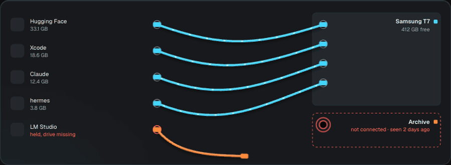
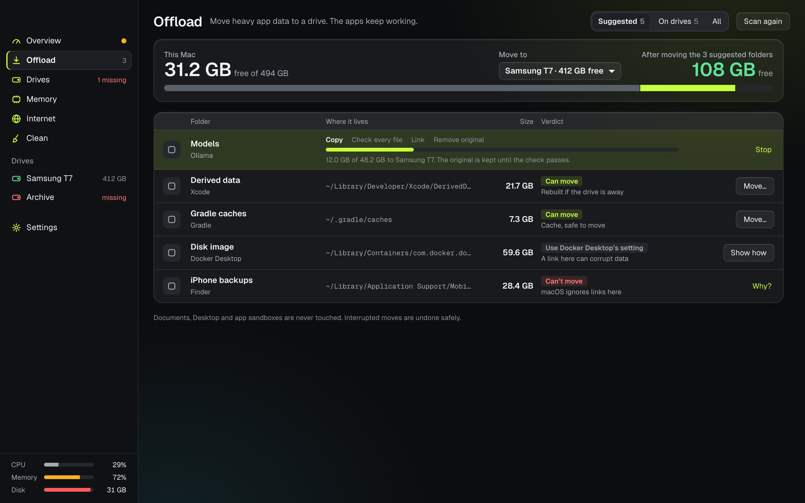
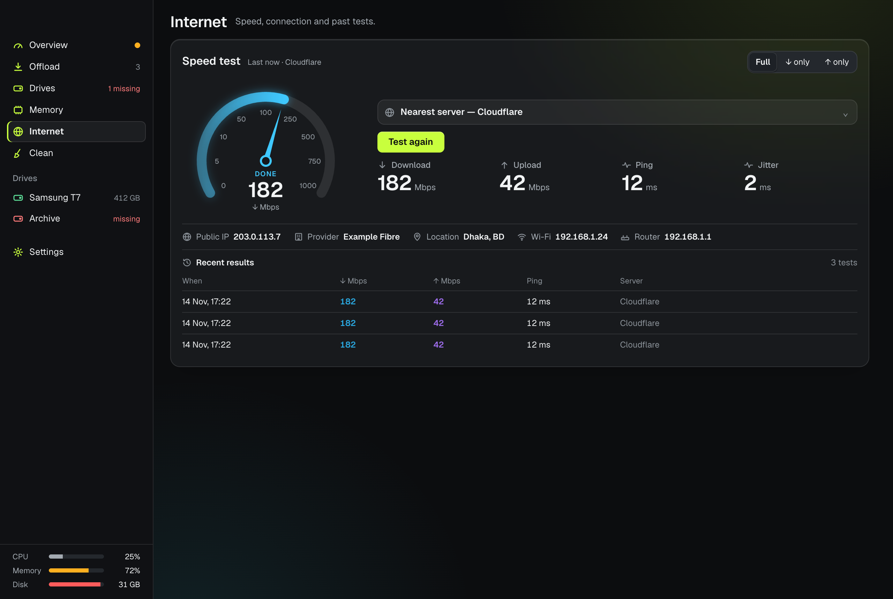
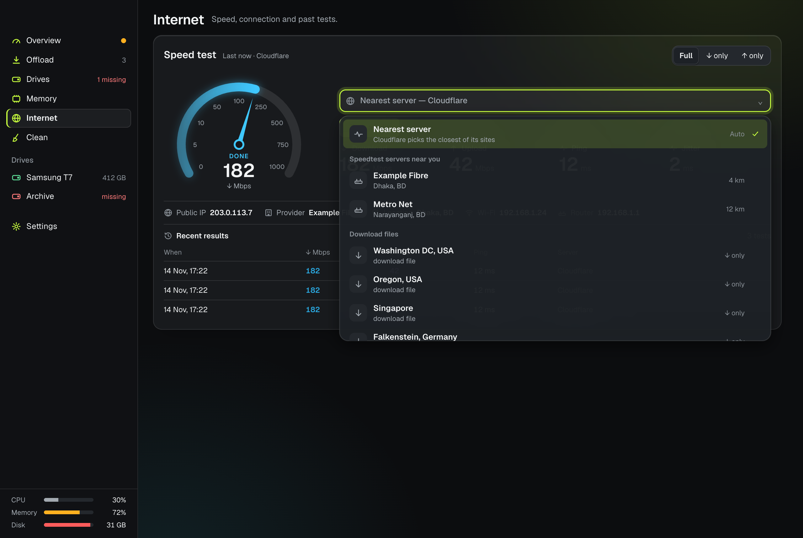
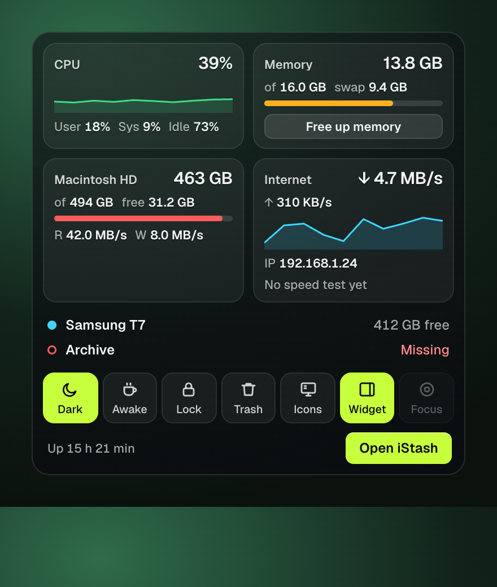
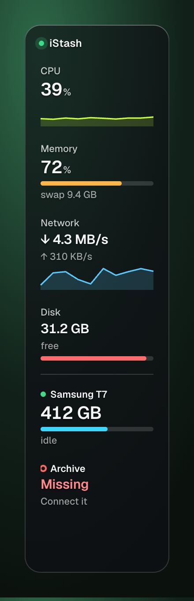
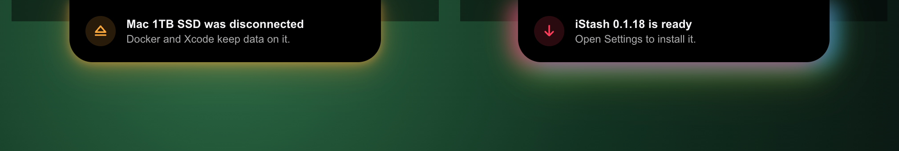
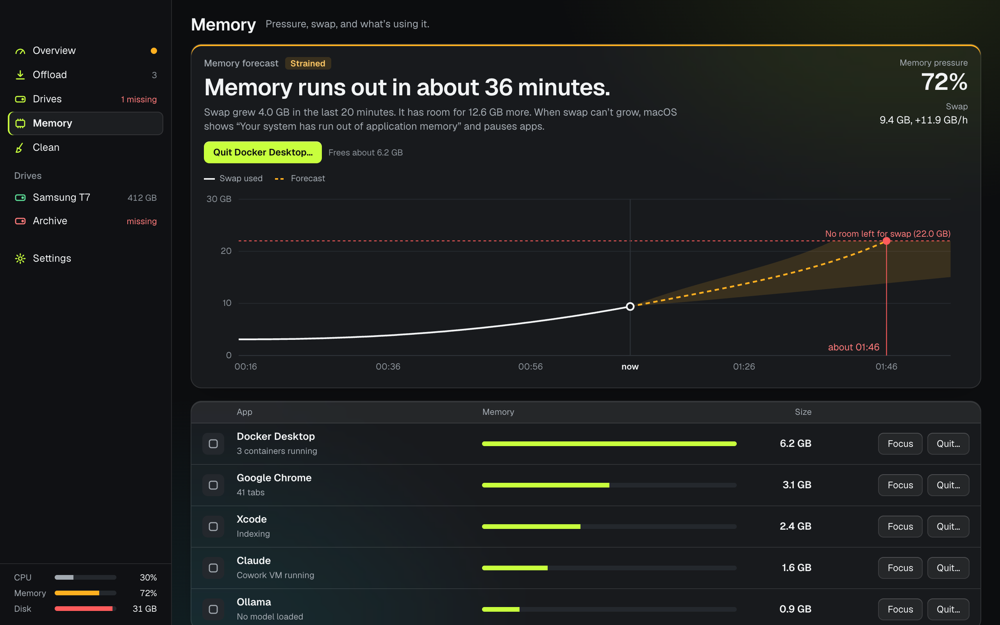
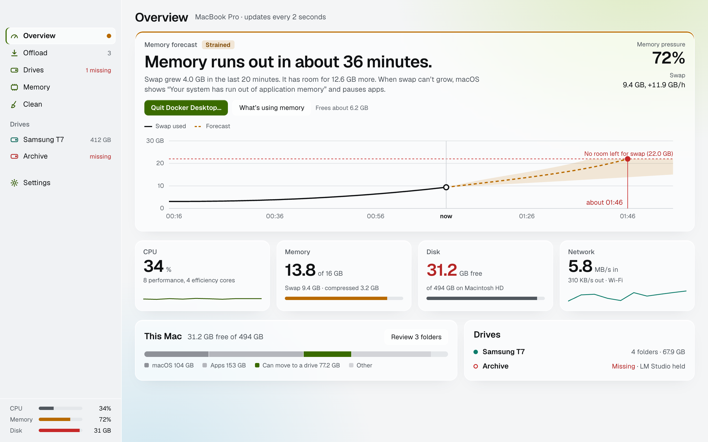
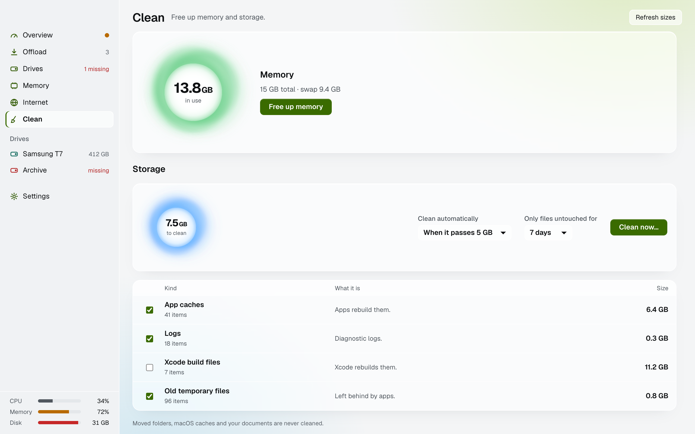

<div align="center">

# iStash

**Make room on your Mac. Keep every app working.**

iStash moves heavy app data to an external drive and leaves a link in its place,
so your apps carry on as if nothing moved.

[](https://github.com/wajedhossainbd/iStash/releases/latest)


[](LICENSE)

[**Download for Mac**](https://github.com/wajedhossainbd/iStash/releases/latest/download/iStash.dmg) · [Install guide](docs/INSTALL.md) · [Why iStash](#what-istash-does-differently) · [Features](#features) · [Changelog](CHANGELOG.md)

[](https://supportkori.com/wajed)

<br>


</div>

## The problem

A 256 GB Mac fills up fast, and most of the weight isn't your files. It's the data apps keep for themselves: AI
models, SDKs, simulators, build caches, Docker and virtual machines. Delete it and the apps download it again. macOS
offers no way to say "keep this app's data on my external drive".

So people move the folders by hand and leave a symbolic link. It works, until:

- the copy was incomplete and nobody checked;
- the drive is unplugged, and the app quietly starts over with an empty folder;
- the drive is ejected while an app is still writing to it;
- months later, nobody remembers which app needs which drive, or how to put a folder back.

## What iStash does differently

iStash makes that move safe, keeps track of it, and watches over it afterwards.

- **Checked, not hoped for.** Every file is copied and compared (count, size, content) before the original is removed.
- **Crash-proof.** Every step goes into a journal. If the Mac sleeps, crashes or loses power mid-move, iStash
  finishes or undoes the move on the next start. Stop any move and everything goes back.
- **Knows which app needs which drive.** The drive map shows each app's data and where it lives.
- **Guards the eject.** macOS asks iStash before an eject; if an app still needs the drive, iStash refuses and
  names the app.
- **Warns when a drive is missing**, and asks you to connect it if you open an app that needs it.
- **Undo is one click.** Bring back any folder iStash moved, whenever you like.
- **Knows what not to touch.** Documents, Desktop, iCloud Drive, Photos, app sandboxes and macOS's own data are off
  limits. No root helper for moving, no account, no tracking.

### How it compares

| | Moves app data and keeps apps working | Checks every file first | Undo and crash recovery | Which app needs which drive | Eject guard | Free and open source |
|---|:-:|:-:|:-:|:-:|:-:|:-:|
| **iStash** | ✓ | ✓ | ✓ | ✓ | ✓ | ✓ |
| Moving folders by hand with a symbolic link | ✓ | – | – | – | – | ✓ |
| An app's own storage setting (Xcode, Docker, Photos, Steam, Ollama…) | for that app only | varies | – | – | – | – |
| Disk space viewers (DaisyDisk, GrandPerspective, OmniDiskSweeper) | – shows space only | – | – | – | – | some |
| Cleaners (CleanMyMac, Pearcleaner) | – deletes, doesn't move | – | – | – | – | some |
| File automation (Hazel) | moves files, not app data behind links | – | – | – | – | – |
| macOS Storage settings and iCloud | – | – | – | – | – | built in |

Many apps on this list are excellent at their own job. As far as we know, none of them moves app data off the Mac
in a way that's checked, reversible and watched over afterwards. That gap is why iStash exists.

**Also in the box**, because a Mac that's short on disk is usually short on memory too: a memory forecast that warns
before macOS runs out, a cleaner, CPU and memory by app, a menu-bar control centre, an edge widget, an internet
speed test, fan control and a notch island for notifications. Other tools do these well too; here they share one
small app and one menu-bar icon.

## Why I built it

I'm Wajed. My Mac mini has 256 GB, and developer tools filled it: Xcode, Docker, Gradle, Rust toolchains, SDKs and
AI tools. I moved their folders to external SSDs by hand and ended up with 23 symbolic links, no record of which app
used which drive, and nothing to stop an app losing its data when a drive wasn't plugged in.

I needed a tool that did this properly, so I built one with AI as my pair programmer. It now looks after the app
data on my own Mac.

## Why it's open source

My motto: **with AI, solve your own problem first, then let others solve theirs.**

iStash solved mine. Plenty of people buy the base-storage Mac and hit the same wall, so the code is free under the
GPL 3.0. Use it, read how every move is checked before trusting it with your data, fix what bothers you, and build
on it. If it saves you an upgrade, [a coffee](https://supportkori.com/wajed) is welcome.

## Features

### The core: moving app data safely

| Feature | What it does |
| --- | --- |
| **Offload app data** | Finds the big app folders that can live on an external drive and moves them with one click. |
| **Safe moves** | Copies, checks every file, leaves a link, then removes the original. Stop at any time and everything is put back. |
| **Crash-proof** | Every step is written to a journal. An interrupted move is finished or undone the next time iStash starts. |
| **Which app needs which drive** | A drive map shows each app's data and where it lives. Open a drive to see every folder on it. |
| **Eject guard** | macOS asks iStash before any eject. If an app still needs the drive, the eject is refused and the app named. |
| **Missing-drive warnings** | A notification when a drive with app data disappears, and a prompt to connect it if you open an app that needs it. |
| **Drive activity** | Read and write speed for each drive, its average, and when it was last busy. |

### Also in the box

| Feature | What it does |
| --- | --- |
| **Notch island** | iStash's notifications drop from the top of the screen as a black pill with a neon glow (amber, blue, pink, green, white or RGB), then shrink back. |
| **Menu-bar panel** | A control-centre panel: live CPU, memory, disk and internet tiles, fan and temperatures, your drives, shortcuts to System Settings, Disk Utility, Activity Monitor, System Information and the camera, and quick toggles for dark mode, keep awake, keep the screen on, lock, empty Trash, desktop icons, the edge widget and Focus. |
| **Fan control** | Let macOS decide, run the fans at full speed, or set a speed yourself, with every temperature sensor listed. Your password is asked once. |
| **Edge widget** | A thin glass column on the left or right edge of the screen with CPU, memory, network, disk, fan and drives. Always on, or slides out when you touch the edge. |
| **Internet** | A live speed gauge with download, upload, ping and jitter; your public IP, provider and location; every past test in one table. |
| **Any test server** | Search Speedtest's servers by city, country or provider, pick a recently used one, or test against any file. |
| **Memory forecast** | Live CPU, memory, disk and network, with a warning before macOS runs out of memory. |
| **What's using the CPU** | The apps and macOS processes using the most CPU, busiest first, counted like Activity Monitor (100% is one core). The two busiest also show in the menu-bar panel. |
| **Focus** | Give one app priority: the other apps run in the background until you stop it. |
| **Clean** | Free up memory with no password, and clear caches, logs, Xcode build files and old temporary files, shown as a glowing orb that pulls the clutter in and tells you what was freed. |
| **Scheduled cleaning** | Clean daily, weekly, monthly, or once the files pass a size such as 5 GB, and only files older than you choose. |
| **Open at login** | Starts with your Mac, so warnings and schedules keep working. |
| **Permissions up front** | Every permission iStash uses is listed in setup and Settings, with Allow all, so it doesn't stop to ask later. |
| **Updates built in** | New versions install from inside the app, each one checked against iStash's signature. |
| **Light and dark** | Follows your Mac's appearance, or pick one. |

## Screenshots

<p align="center"><br><sub><b>The drive map</b> · data flows along each cable; hover to follow one, and watch a drive plug in and out</sub></p>

<table>
  <tr>
    <td width="50%"><br><sub><b>Offload</b> · big app folders, and the drive they move to</sub></td>
    <td width="50%"><br><sub><b>Moving</b> · copy, check every file, link, remove the original</sub></td>
  </tr>
  <tr>
    <td><br><sub><b>Drives</b> · which app needs which drive</sub></td>
    <td><br><sub><b>Overview</b> · live numbers and the memory forecast</sub></td>
  </tr>
  <tr>
    <td><br><sub><b>Internet</b> · live speed gauge, connection details and every past test</sub></td>
    <td><br><sub><b>Test servers</b> · search by city, country or provider</sub></td>
  </tr>
  <tr>
    <td><br><sub><b>Menu-bar panel</b> · live tiles, fan control, shortcuts and quick toggles</sub></td>
    <td align="center"><br><sub><b>Edge widget</b> · on the edge of your screen</sub></td>
  </tr>
  <tr>
    <td colspan="2"><br><sub><b>Notch island</b> · notifications from the top of the screen, in the glow you pick</sub></td>
  </tr>
  <tr>
    <td><br><sub><b>Memory</b> · what's using memory and CPU, and Focus</sub></td>
    <td><br><sub><b>Clean</b> · freeing memory, by hand or on a schedule</sub></td>
  </tr>
</table>

### Light theme

<table>
  <tr>
    <td width="50%"></td>
    <td width="50%"></td>
  </tr>
</table>

## Install

**Requirements:** macOS 14 Sonoma or newer, on a Mac with Apple Silicon (M1 or later).
The download is about 3 MB and the installed app about 6 MB.

Step by step, with pictures, first launch, troubleshooting and uninstalling: **[the install guide](docs/INSTALL.md)**.

### One command (recommended)

```sh
curl -fsSL https://github.com/wajedhossainbd/iStash/releases/latest/download/install.sh | sh
```

It installs iStash in Applications and opens it, with no warnings.

### Download

Get [**iStash.dmg**](https://github.com/wajedhossainbd/iStash/releases/latest/download/iStash.dmg).

> [!NOTE]
> iStash isn't notarised by Apple yet, so macOS says **"iStash.dmg" Not Opened**. To open it anyway:
> 1. Click **Done**.
> 2. Open **System Settings › Privacy & Security**, scroll down to the message about iStash.dmg and click
>    **Open Anyway**, then confirm with your password.
> 3. Drag iStash into Applications. If macOS asks again when you open iStash, repeat step 2.
>
> Or clear the download flag in Terminal, then open the DMG as usual:
>
> ```sh
> xattr -d com.apple.quarantine ~/Downloads/iStash.dmg
> ```

### Updates

iStash checks for a new version at launch and every six hours. When one is ready, Settings shows an **Update**
button; iStash installs it and restarts.

## Privacy and safety

- **Never touched:** Documents, Desktop, iCloud Drive, Photos, Mail and app sandboxes.
- **No account, no analytics.** iStash only goes online to check for updates.
- **Drives:** APFS or Mac OS Extended. exFAT and FAT can't hold links safely, so iStash won't use them.
- **Cleaning** deletes for good, never touches folders moved to a drive or macOS's own caches, and always shows what
  it will remove first.

## Build from source

You need Node 22, Rust (stable) and Xcode's command line tools.

```sh
git clone https://github.com/wajedhossainbd/iStash.git
cd iStash/app/ui
npm install
npm run app:build    # → app/src-tauri/target/release/bundle/macos/iStash.app
```

`npm run app:dev` runs the app with hot reload; `npm run dev` shows the UI alone in a browser on sample data.

<details>
<summary><b>Releases and repository layout</b></summary>

<br>

Every push to `main` runs [`release.yml`](.github/workflows/release.yml): it tests the app, builds the next version,
and publishes a release with `iStash.dmg`, the signed update package and `install.sh`. Updates are signed with the
repository secret `TAURI_SIGNING_PRIVATE_KEY`; the matching public key is in `app/src-tauri/tauri.conf.json`.

| Folder | What's in it |
| --- | --- |
| `app/` | The app: Tauri shell (`src-tauri/`) and UI (`ui/`) |
| `crates/` | The Rust engine and command line tool |
| `design/` | Design tokens, system notes and the prototype |
| `docs/screenshots/` | The pictures on this page, taken on sample data |

</details>

## Changelog

What changed in each version is in [CHANGELOG.md](CHANGELOG.md), and on each [release](https://github.com/wajedhossainbd/iStash/releases).

## Support

iStash is free. If it saved you a drive's worth of space, you can [buy me a coffee](https://supportkori.com/wajed).

## License

iStash is free software under the [GNU General Public License v3.0](LICENSE). You may use, study, share and change
it; if you distribute a version based on it, it must also be under the GPL.
