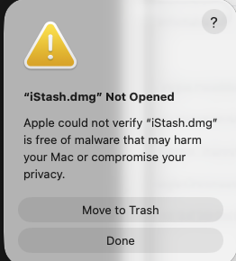
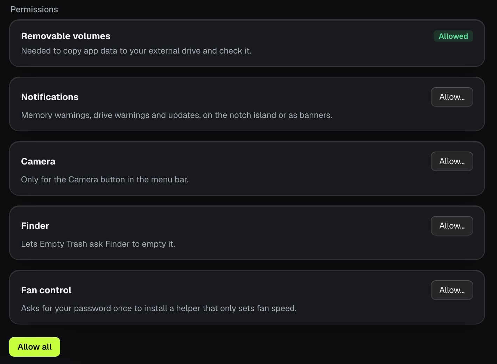
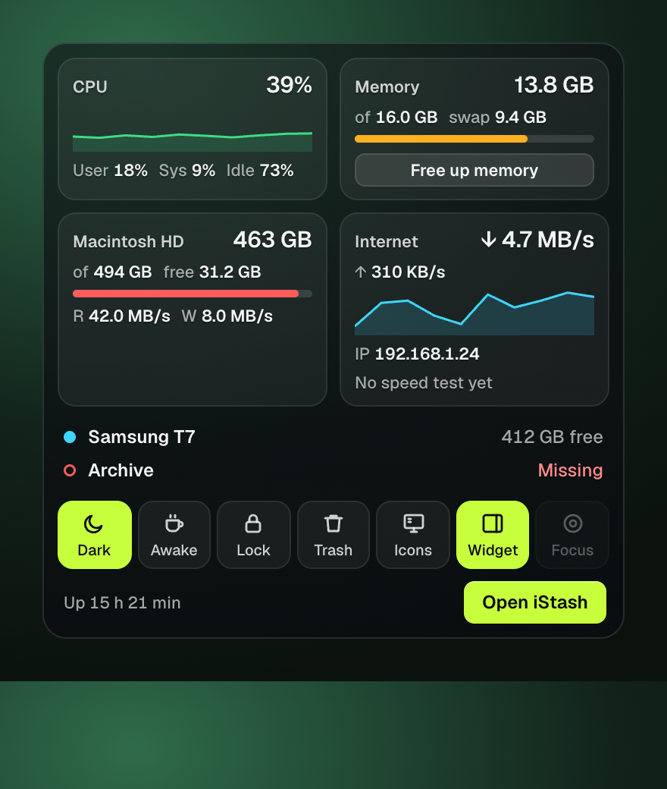

# Installing iStash

iStash runs on **macOS 14 Sonoma or newer**, on a Mac with **Apple Silicon** (M1 or later). To check, open
Apple menu › About This Mac: the chip should say Apple M1, M2, M3, M4 or later.

There are two ways to install it. The first is quicker and shows no warnings.

## Way 1: one command (recommended)

1. Open **Terminal**: press ⌘ Space, type `Terminal`, press Return.
2. Copy this line, paste it into Terminal and press Return:

   ```sh
   curl -fsSL https://github.com/wajedhossainbd/iStash/releases/latest/download/install.sh | sh
   ```

3. Wait for **"iStash is installed in Applications and open."** iStash opens by itself.

The command downloads the latest release from this repository, copies iStash into Applications and opens it. It
asks for no password. Run the same command again any time to reinstall.

## Way 2: download the DMG

1. Download [**iStash.dmg**](https://github.com/wajedhossainbd/iStash/releases/latest/download/iStash.dmg) and
   double-click it in Downloads.
2. macOS says **"iStash.dmg" Not Opened** and "Apple could not verify…". This is expected: iStash isn't notarised
   by Apple yet (that needs a paid Apple Developer account). Click **Done**, not Move to Trash.

   

3. Open **System Settings › Privacy & Security** and scroll to the bottom. Next to "iStash.dmg was blocked", click
   **Open Anyway**, then **Open Anyway** again and enter your Mac's password.
4. The DMG opens. Drag **iStash** onto the **Applications** folder.
5. Open iStash from Applications. If macOS shows the same warning for the app, repeat step 3 for "iStash".

You only do this once. After that iStash opens normally and updates itself without warnings.

**Shortcut for step 2 and 3:** in Terminal, run this before opening the DMG:

```sh
xattr -d com.apple.quarantine ~/Downloads/iStash.dmg
```

## First launch

iStash walks you through three short steps:

1. **Welcome:** what iStash does. Nothing is moved until you choose.
2. **Permissions:** press **Allow all**, or allow each one. macOS asks once for each, in iStash's name:

   | Permission | What it's for |
   |---|---|
   | Removable volumes | Copying app data to your external drive and checking it. Needed to move anything. |
   | Notifications | Drive and memory warnings, and updates, on the notch island or as banners. |
   | Camera | Only the Camera button in the menu-bar panel. |
   | Finder | Lets Empty Trash ask Finder to empty it. |
   | Fan control | Asks for your password once, to install a small helper that only sets fan speed. |

   Each one is optional except removable volumes. You can allow them later in **Settings › Permissions**.

   

3. **Choose a drive:** the external drive iStash moves app data to. You can pick a different drive for each move.



iStash then lives in the menu bar (the iStash icon, top right); click it for the panel on the right. Closing the window or pressing ⌘Q keeps it running
there; to quit completely, right-click the menu-bar icon and choose **Quit iStash**. Turn on **Settings › Open at
login** so drive warnings and cleaning schedules keep working after a restart.

<br clear="right">

## Updates

iStash checks for a new version when it starts and every six hours. When one is ready, **Settings** shows an
**Update** button: iStash installs it and restarts. Every update is checked against iStash's signature, and your
settings, permissions and moved folders carry over.

## Troubleshooting

| What you see | What to do |
|---|---|
| "iStash.dmg" Not Opened, or "iStash" Not Opened | Follow step 3 of Way 2, or use Way 1. |
| "iStash is damaged and can't be opened" | macOS's download flag again. Run `xattr -dr com.apple.quarantine /Applications/iStash.app` in Terminal. |
| The Camera window says camera access is off, and iStash isn't in System Settings › Camera | Run `tccutil reset Camera bd.wajed.stowaway` in Terminal, then press Camera again and click Allow. |
| iStash can't see an external drive | Settings › Permissions › Removable volumes › Allow, or System Settings › Privacy & Security › Files and Folders › iStash › Removable Volumes. |
| "This build is for Apple Silicon Macs" | iStash doesn't run on Intel Macs yet. |

## Uninstalling

Moved folders stay on your external drive, with a link where they used to be, and keep working without iStash as
long as the drive is connected. If you want a folder back on your Mac, open iStash and use **Bring back** on it
before uninstalling.

1. Right-click the iStash menu-bar icon and choose **Quit iStash**.
2. Drag **iStash** from Applications to the Bin. Its login item goes with it.
3. If you used fan control, remove its helper in Terminal (asks for your password):

   ```sh
   sudo rm /Library/PrivilegedHelperTools/bd.wajed.stowaway.fan
   ```

4. Optional: delete `~/Library/Application Support/Stowaway`, iStash's move journal. Keep it if any folders are
   still moved, so a reinstalled iStash can bring them back.
